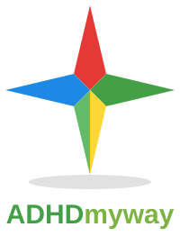

# ADHD My Way



My first project during my internship as a software engineer touched up with modern skills. Originally built on Ionic 4 framework. Now updated with Ionic 8 framework.

An **Ionic** mobile app that helps children under 12 focus on their daily tasks — with
coins, a customisable avatar, and mini games to keep it fun.

> **Day 1 of the 100-day programming challenge** (8 Nov 2026). v1 launch.
> Roadmap: v2 focus timer + task categories + streaks · v3 new mini game + more
> avatar items · v4 weekly rewards / achievements + summary screen.
>
> **Update (8 Nov 2026)** — phone-friendly layout (the app now sits in a
> centred phone-width column on wide screens, with bigger tap targets) and
> the official ADHD My Way logo, shown in the app header and above.
>
> **Update — v2 (12 Nov 2026, Day 5 of the challenge)** — per-quest focus
> timer (tap Focus on a quest and finishing the timer ticks that quest off),
> quest categories (Morning / School / Home / Health / Fun, with filter
> chips and a group picker when adding a quest), and daily streaks (a day
> counts when at least one quest is finished; the best streak is tracked).
> Saved v1 data carries over — coins, quests and avatar are kept.

## What it does

- **Daily quests** — a simple checklist (brush teeth, homework, tidy room, read
  10 minutes…). Ticking one off earns **10 coins**. Kids can add their own quests
  (choosing a group: Morning, School, Home, Health or Fun). The list resets each
  morning; coins stay.
- **Quest groups** — every quest belongs to a group, and filter chips above the
  list show just one group at a time (e.g. only the morning routine).
- **Daily streaks** — a day counts when at least one quest is finished. The app
  shows the current streak and the best streak so far; missing a day restarts it.
- **Focus timer** — pick a quest to focus on (tap **Focus** next to it), choose
  5 / 10 / 15 minutes, and press start. Finishing the timer ticks that quest off
  (+10 coins) and adds a **+5 coin** focus bonus. It also works with no quest picked.
- **Avatar shop** — coins buy avatar customisations: skin colours, hair styles and
  colours, hats (cap, beanie, gold crown) and accessories (star badge, glasses,
  headphones). The avatar is drawn from plain shapes and colours.
- **Mini games** (both earn coins):
  - **Memory Match** — flip cards, find all 6 shape pairs, win **20 coins**.
  - **Tap the Star** — tap the star as many times as you can in 30 seconds,
    **+2 coins** per tap.
- **Everything persists on the device** via `localStorage` — coins, quests,
  avatar and shop purchases survive closing the app.

## Privacy — built for children under 12

- **No accounts, no sign-in, no ads, no analytics, no network calls.**
- All data stays in `localStorage` on the device; nothing leaves it.
- Sample quests only — no real children's data anywhere in the app.

## Stack

- [Ionic Framework 8](https://ionicframework.com/) (`ion-app`, `ion-tabs`,
  `ion-content`, `ion-card`, `ion-list`, `ion-checkbox`, `ion-button`, …) —
  real Ionic web components, bundled locally with Vite (no CDN at runtime).
- [Capacitor 7](https://capacitorjs.com/) config included (`capacitor.config.json`)
  so the same code can be wrapped as a native app later.
- Vanilla JavaScript + Vite. Game/task/shop rules live in `src/logic.js`
  (pure functions, unit-tested with Node's built-in test runner).

## Run it

```bash
npm install

# Development server (hot reload)
npm run dev

# Production web build -> www/ (this is what GitHub Pages serves)
npm run build

# Preview the production build
npm run preview

# Or simply open the built app
open www/index.html
```

## Tests

```bash
npm test
# 14 tests: task coins, daily reset, shop purchases, memory deck, rewards,
# quest categories, daily streaks, per-quest focus sessions, v1 save migration
```

## Project structure

```
adhd-my-way/
├── index.html            # Ionic shell: 3 tabs (Quests / Games / Avatar)
├── package.json          # Ionic + Capacitor deps, Vite build, npm test
├── capacitor.config.json # Capacitor app id / name / webDir
├── ionic.config.json     # Ionic project type
├── vite.config.js        # relative base so it works under GitHub Pages
├── public/               # official logo files (logo.svg, logo-star.svg)
├── src/
│   ├── main.js           # Ionic wiring: tabs, timer, games, shop, storage
│   ├── logic.js          # pure rules (coins, tasks, shop, decks) — tested
│   └── style.css         # bright, simple, kid-friendly styling
├── tests/
│   └── logic.test.js     # 9 Node tests for src/logic.js
└── www/                  # production build output (built by running npm run build)
```

## License

MIT — portfolio demo project.
