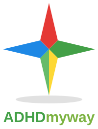

# ADHD My Way



My first project during my internship as a software engineer touched up with modern skills. Originally built on Ionic 4 framework. Now updated with Ionic 8 framework.

An **Ionic** mobile app that helps children under 12 focus on their daily tasks — with
coins, a customisable avatar, and mini games to keep it fun.

> **Day 1 of the 100-day programming challenge** (8 Nov 2026). v1 launch.
> Roadmap: v2 focus timer + task categories + streaks (done) · v3 new mini game
> (Colour Match) + more avatar items (done, 20 Nov 2026) · v4 weekly rewards /
> achievements + summary screen (done, 22 Nov 2026).
>
> **Update (8 Nov 2026)** — phone-friendly layout (the app now sits in a
> centred phone-width column on wide screens, with bigger tap targets) and
> the official ADHD My Way logo, shown in the app header and above.
>
> **Update — v2 (12 Nov 2026, Day 5 of the challenge)** — per-quest focus
> timer (tap Focus on a quest and finishing the timer ticks that quest off),
> quest categories (Morning / School / Home / Health / Fun, with filter
> chips and a group picker when adding a quest), and daily streaks (a day
> counts when at least one quest is finished; the best streak is tracked).
> Saved v1 data carries over — coins, quests and avatar are kept.
>
> **Update — v3 (20 Nov 2026, Day 1 of the restarted challenge)** — a third
> mini game, **Colour Match** (read the colour word, tap the button in that
> colour — 10 rounds, +2 coins per right tap, +10 bonus for finishing), and
> more avatar shop items (Golden skin, ponytail hair, purple hair, party hat,
> wizard hat, heart badge, sunglasses). Saved v1/v2 data carries over —
> coins, quests, avatar and streaks are kept, and the new colour stats start
> at zero.
>
> **Update — v4 (22 Nov 2026, Day 3 of the restarted challenge)** — a new
> **My Stars** tab: a **weekly star reward** (finish 10 quests in one week,
> Monday to Sunday, and claim 50 bonus coins — once per week), **10
> achievements** to earn (First Steps, Quest Hero, Quest Champion, On Fire,
> Super Streak, Memory Champion, Colour Star, Star Tapper, Focused, Big
> Spender — a toast celebrates each new badge as it is earned), and a
> **summary screen** with everything done so far (quests, games, stars
> tapped, focus sessions, Colour Match score, best streak, this week's
> totals). Saved v1/v2/v3 data carries over — coins, quests, avatar,
> streaks and stats are kept, and badges are earned from what was already
> done.

## What it does

- **Daily quests** — a simple checklist (brush teeth, homework, tidy room, read
  10 minutes…). Ticking one off earns **10 coins**. Kids can add their own quests
  (choosing a group: Morning, School, Home, Health or Fun). The list resets each
  morning; coins stay.
- **Quest groups** — every quest belongs to a group, and filter chips above the
  list show just one group at a time (e.g. only the morning routine).
- **Daily streaks** — a day counts when at least one quest is finished. The app
  shows the current streak and the best streak so far; missing a day restarts it.
- **Focus timer** — pick a quest to focus on (tap **Focus** next to it), choose
  5 / 10 / 15 minutes, and press start. Finishing the timer ticks that quest off
  (+10 coins) and adds a **+5 coin** focus bonus. It also works with no quest picked.
- **Avatar shop** — coins buy avatar customisations: skin colours, hair styles and
  colours (including a ponytail and purple hair), hats (cap, beanie, party hat,
  wizard hat, gold crown) and accessories (star badge, heart badge, glasses,
  sunglasses, headphones). The avatar is drawn from plain shapes and colours.
- **Mini games** (all earn coins):
  - **Memory Match** — flip cards, find all 6 shape pairs, win **20 coins**.
  - **Tap the Star** — tap the star as many times as you can in 30 seconds,
    **+2 coins** per tap.
  - **Colour Match** — read the colour word, then tap the button in that colour.
    10 rounds, **+2 coins** per right tap and a **+10 coin** bonus for finishing.
- **Weekly star reward** — finish 10 quests in one week (Monday to Sunday)
  and claim **50 bonus coins** from the My Stars tab. The reward can only be
  claimed once per week, and a new week starts fresh.
- **Achievements** — 10 badges to earn by playing: finishing quests, keeping
  streaks, winning games, tapping stars, focusing, and buying a shop item.
  A toast celebrates each new badge the moment it is earned.
- **Summary screen** — the My Stars tab shows everything done so far: quests
  finished, games won, stars tapped, focus sessions, Colour Match score, best
  streak, and this week's totals.
- **Everything persists on the device** via `localStorage` — coins, quests,
  avatar and shop purchases survive closing the app.

## Privacy — built for children under 12

- **No accounts, no sign-in, no ads, no analytics, no network calls.**
- All data stays in `localStorage` on the device; nothing leaves it.
- Sample quests only — no real children's data anywhere in the app.

## Stack

- [Ionic Framework 8](https://ionicframework.com/) (`ion-app`, `ion-tabs`,
  `ion-content`, `ion-card`, `ion-list`, `ion-checkbox`, `ion-button`, …) —
  real Ionic web components, bundled locally with Vite (no CDN at runtime).
- [Capacitor 7](https://capacitorjs.com/) config included (`capacitor.config.json`)
  so the same code can be wrapped as a native app later.
- Vanilla JavaScript + Vite. Game/task/shop rules live in `src/logic.js`
  (pure functions, unit-tested with Node's built-in test runner).

## Run it

```bash
npm install

# Development server (hot reload)
npm run dev

# Production web build -> www/ (this is what GitHub Pages serves)
npm run build

# Preview the production build
npm run preview

# Or simply open the built app
open www/index.html
```

## Tests

```bash
npm test
# 31 tests: task coins, daily reset, shop purchases, memory deck, rewards,
# quest categories, daily streaks, per-quest focus sessions, v1/v2/v3 save
# migration, colour-match rounds and rewards, v3 shop items, weekly reward
# (goal, claim-once, week rollover), achievements, summary screen
```

## Project structure

```
adhd-my-way/
├── index.html            # Ionic shell: 4 tabs (Quests / Games / My Stars / Avatar)
├── package.json          # Ionic + Capacitor deps, Vite build, npm test
├── capacitor.config.json # Capacitor app id / name / webDir
├── ionic.config.json     # Ionic project type
├── vite.config.js        # relative base so it works under GitHub Pages
├── public/               # official logo files (logo.svg, logo-star.svg)
├── src/
│   ├── main.js           # Ionic wiring: tabs, timer, games, shop, storage
│   ├── logic.js          # pure rules (coins, tasks, shop, decks) — tested
│   └── style.css         # bright, simple, kid-friendly styling
├── tests/
│   └── logic.test.js     # 22 Node tests for src/logic.js
└── www/                  # production build output (built by running npm run build)
```

## License

MIT — portfolio demo project.
